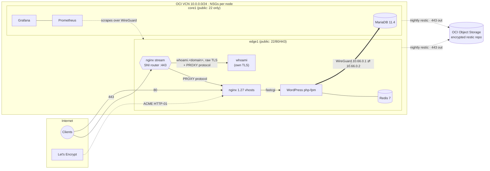

# infra-platform


Ansible-managed two-node infrastructure on Oracle Cloud (ARM64):
a public **edge** node serving web workloads and an internal **core** node
serving the database, connected by an encrypted WireGuard overlay. A bare
Ubuntu instance becomes a fully configured node — hardened SSH, default-drop
firewall, Docker runtime, application stacks, TLS certificates, scheduled
maintenance, encrypted offsite backups — in a single playbook run.

Besides the site and the blog, the edge serves
[whoami](roles/whoami/files/app/README.md), a browser fingerprint test that
shows visitors the identity any website can give them without cookies,
including the TLS and HTTP/2 fingerprints only a server can see.

Everything is code: playbook runs are idempotent, and manual changes
are treated as drift to be erased by the next run.

## Architecture



Two firewall layers, independently default-deny (whoami added no rules: it
publishes no ports and is reached through nginx):

| Layer | Mechanism | edge1 | core1 |
|---|---|---|---|
| Cloud | OCI Network Security Groups | 22, 80, 443 public; 51820/udp from core's NSG | 22 public; 51820/udp from edge's NSG |
| Host | nftables (input **and** forward drop by default) | + 80/443 in FORWARD (container DNAT) | tunnel + established only |

All internal traffic — database and monitoring — uses the WireGuard tunnel
and binds exclusively to `10.66.0.x` addresses. Nothing internal is reachable
from the public network. Backups add no inbound surface either: both nodes
push client-side-encrypted snapshots to object storage over outbound
HTTPS only.

## Design

**Some services terminate their own TLS.** whoami has to read the raw
ClientHello and HTTP/2 frames, which a reverse proxy would consume. So
nginx's stream module owns port 443 on the edge: it reads only the SNI, and
either splices the encrypted stream to that service or hands it to nginx's
own HTTPS listener on loopback, prepending a PROXY protocol header both ways
so every backend still sees the real client address (`realip` restores it
for the vhosts, and `port_in_redirect off` keeps the internal port out of
generated redirects). The passthrough list is one variable,
`web_tls_passthrough`; when it is empty the configuration is the stock one.
Each passthrough service gets its own certificate, so its container never
holds the main site's key, and browsers never reuse one site's connection
for another. A misrouted request gets 421 Misdirected Request, which makes
browsers retry on a fresh connection.

**whoami keeps nothing it shows.** The page reads about forty
script-visible signals; the server adds JA4/JA3 and HTTP/2 fingerprints, the
network and location of the IP address (DB-IP Lite, refreshed monthly) and
the Tor exit list (hourly), and cross-checks them the way bot-detection
services do. Each identity is drawn as a passport (name, animal, colours,
guilloché rosette, a machine-readable zone with real check digits) derived
from its hash. Only a scan the visitor starts is stored, and only as
HMAC-SHA256 values under a secret generated on the node: no IP addresses,
raw values or User-Agent strings. Records expire 180 days after the last
scan, "Forget this browser" deletes them immediately, and the data directory
is deliberately left out of backups so that deletion is real. The page loads
nothing from third parties (fonts and FingerprintJS are self-hosted, its
telemetry off) except a STUN request when the visitor runs the WebRTC test,
and nginx's stream proxy keeps no access log.

**Images can be built on the node.** whoami's image is built on the edge
from the source in its role and tagged with a hash of the build context:
unchanged source means no rebuild and no restart, so steady-state runs stay
change-free, and a source change rolls out on the next run. The Go version
is pinned in the Dockerfile and updated by pull request. The container is
read-only, drops every capability, and picks up renewed certificates by
itself.

**Container port bindings are always explicit.** Every published port in a
compose file states its bind address (`127.0.0.1`, a tunnel address, or
`0.0.0.0`) — bare `port:port` mappings are forbidden, because Compose fills
in `0.0.0.0` itself rather than deferring to the daemon's default bind
address. Docker's `daemon.json` still sets `"ip": "127.0.0.1"` as a backstop
for anything started outside compose.

**Host firewall covers FORWARD and INPUT.** Traffic to published
container ports is DNAT'd and traverses the FORWARD chain; a firewall that
only filters INPUT does not filter containers. The nftables ruleset drops
both chains by default and opens 80/443 in FORWARD on the edge only.

**Firewall changes have auto rollback.** The nftables role starts a
`systemd-run` timer that flushes the ruleset after 3 minutes, applies
the new rules, re-establishes a fresh SSH connection to prove reachability,
and only then stops the timer.

**Service lifecycles are declared in systemd.**
`docker.service` carries two drop-ins: `After=/Wants=wg-quick@wg0` (containers
bind to tunnel addresses, so the tunnel must exist first) and
`PartOf=nftables.service` (an nftables restart flushes Docker's NAT rules;
PartOf restarts Docker automatically so DNAT is rebuilt without intervention).

**Databases get time to shut down.** Docker's default 10-second
SIGTERM→SIGKILL window is too short for a database mid-flush. The daemon's
`shutdown-timeout` is raised to 60s and MariaDB's `stop_grace_period` to 1m,
so daemon restarts (which the PartOf binding makes routine) never kill the
DB uncleanly.

**TLS between nodes is delegated to WireGuard.** MariaDB is reached with TLS
verification disabled *inside the tunnel*: the transport is already
authenticated and encrypted end-to-end by WireGuard, and a self-signed
database certificate would add verification failures without adding security.

**Certificate domains are configuration.** The web role compares the SANs of
the live certificate against the declared `web_cert_domains` list and invokes
certbot only on mismatch. Adding a subdomain is a one-line variable change;
steady-state runs never contact Let's Encrypt. On a bare node the role
bootstraps in order — HTTP-only vhosts, ACME issuance, re-render with TLS —
so a fresh instance reaches HTTPS in the same single run. Renewal timing is
owned separately by a systemd timer (twice daily, randomized, `Persistent=`).

**Application provisioning is headless.** WordPress is installed by `wp-cli`
(a compose `tools` profile, like certbot) during the playbook run, with the
admin password from Ansible Vault. The public `install.php` window is
reduced to the seconds between stack start and the install task; no browser
setup step exists. The Redis object cache plugin is installed and enabled the
same way, gated on the presence of its drop-in file for idempotence.

**Updates are automated on two clocks.** WordPress core and plugins
self-update via WP's own mechanism, driven by a real systemd timer running
`wp cron` every 15 minutes (php-fpm's visit-triggered pseudo-cron is disabled).
Container images track their pinned major/minor tags via `pull: always`,
making every playbook run the image-update channel with changes visible
in the run recap. The metrics exporters pin exact versions and update
by pull request instead.

**Monitoring is tunnel-only and provisioned as code.** Prometheus and Grafana
run on the private core node, host-networked and bound to the WireGuard address;
observability images pin exact versions and update by pull request. No firewall
ports were added: scrapes leave core over the tunnel and return as established
traffic, and admin access is an SSH port-forward. Grafana is provisioned
entirely from the repository.

**Backups are restic to object storage, and the restore is the test.**
Nightly systemd timers push the data layer offsite: a consistent MariaDB
logical dump on core; the WordPress tree and the Let's Encrypt directory
on edge. Restic encrypts and deduplicates client-side before anything
reaches the OCI bucket. Configuration is deliberately not backed up - it
rebuilds from this repository and caches and metrics history regenerate.
Retention is 7 daily + 4 weekly snapshots, pruned and checked weekly.

**Secrets never leave the vault layer.** All credentials live in an encrypted
`group_vars/all/vault.yml`; templates reference intermediate variables, never
`vault_*` names directly. Compose files that embed secrets are deployed mode
`0600` with `diff: false`. The real inventory (IPs, key paths) is gitignored;
`inventory.example.yml` documents its shape.

**The pipeline is the deployment path.** Every push and pull request runs
`ansible-lint --strict`, and the full playbook deploys from a GitHub-hosted
runner. The runner holds no standing state — a dedicated deploy SSH key,
the vault password, and the real inventory are injected from repository
secrets at runtime.

## Repository layout

```
.github/workflows/       # CI: lint on push/PR · CD: deploy on dispatch
site.yml                 # base → firewall (serial) → runtime → db (core) →
                         #   web (edge) → whoami (edge) → exporters →
                         #   monitoring (core) → backups
inventory.example.yml    # sanitized inventory shape; real inventory is gitignored
requirements.yml         # Ansible collections
requirements.txt         # Python toolchain (ansible, ansible-lint)
group_vars/
  all/                   # domain, WG public keys, encrypted vault
  core/  edge/           # per-group service variables
host_vars/               # per-node WireGuard addressing
roles/
  bootstrap/             # packages, hostname, timezone, unattended upgrades
  ssh/                   # hardening drop-in (key-only, validated before reload)
  wireguard/             # wg0 tunnel from vaulted keys
  nftables/              # default-drop ruleset with self-reverting rollout
  docker/                # engine (deb822 repo), daemon.json, systemd drop-ins
  exporters/             # exporters for monitoring stack
  mariadb/               # DB stack on core, tunnel-only binding
  monitoring/            # Prometheus + Grafana
  backup/                # restic → OCI object storage
  web/                   # nginx + WordPress + Redis, declarative TLS, timers,
                         #   SNI router for TLS passthrough
  whoami/                # browser fingerprint test: Go service built on the
                         #   node, own TLS, JA4/HTTP2 fingerprints, DB-IP
```

## Quickstart

Requires two Ubuntu 24.04 hosts reachable over SSH, a domain with A
records pointing at the edge node's public IP (the domain, `www`, `blog`,
`status` and `whoami`), and an OCI Object Storage
bucket with a Customer Secret Key (S3-compatible credentials) for backups.

```bash
python3 -m venv .venv_ansible && source .venv_ansible/bin/activate
pip install -r requirements.txt
ansible-galaxy collection install -r requirements.yml

cp inventory.example.yml inventory.yml       # change IPs and key paths

# Create your own vault:
echo 'your-vault-passphrase' > .ansible-vault-pass-infra   # gitignored
ansible-vault create group_vars/all/vault.yml
```

The vault must define: `vault_wg_private_key_edge`,
`vault_wg_private_key_core` (from `wg genkey`; put the matching public keys
in `group_vars/all/vars.yml`), `vault_mariadb_root_password`,
`vault_mariadb_wp_password`, `vault_wordpress_admin_password`,
`vault_grafana_admin_password`, and for backups `vault_restic_password`,
`vault_oci_s3_access_key`, `vault_oci_s3_secret_key`,
`vault_backup_s3_bucket`, `vault_backup_s3_namespace`,
`vault_backup_s3_region`. Set `domain`, `certbot_email`, and
`web_cert_domains` for your environment.

```bash
ansible-lint            # lints clean
ansible-playbook site.yml
ansible-playbook site.yml # idempotence check: expect no changes except fallback
```

## Verification

Run after any significant change:

```bash
ssh edge1 'sudo wg show wg0'                     # handshake < ~30s
ssh edge1 'ping -c 3 10.66.0.2'                  # tunnel path
curl -I https://<domain>                         # HTTP/2 200, Let's Encrypt cert
curl -I http://<domain>                          # 301 → https
curl -I https://blog.<domain>                    # 200 (WordPress, DB over tunnel)
curl https://whoami.<domain>                     # what the connection reveals: IP,
                                                 #   network, JA4, HTTP/2 fingerprint
ssh edge1 'sudo docker inspect -f "{{.State.Health.Status}}" whoami'   # healthy
ssh edge1 'cd /opt/stacks/web && sudo docker compose run --rm -T \
  wpcli wp core is-installed && echo ok'         # checks the container→DB path
ssh edge1 'sudo docker exec redis redis-cli info keyspace'   # object cache populated
ssh edge1 'systemctl list-timers | grep -E "certbot|wp-cron"'
ssh core1 'sudo restic-wrap snapshots | tail -5'             # both hosts' backups
```

The firewall/runtime integration test — restart the firewall and confirm
the public ports return without manual intervention:

```bash
ssh edge1 'sudo systemctl restart nftables' && sleep 30 && curl -I https://<domain>
```

Backups restoration test: the dump is imported into a throwaway database and
files are compared against a scratch restore.

```bash
# core: the database comes back, end to end
sudo install -d -m 700 /tmp/drill
sudo restic-wrap restore latest --host core1 --target /tmp/drill
sudo docker run --rm -d --name drilldb -e MARIADB_ROOT_PASSWORD=drill mariadb:11.4
until sudo docker exec -e MYSQL_PWD=drill drilldb mariadb -uroot -e 'SELECT 1' \
  >/dev/null 2>&1; do sleep 2; done
sudo docker cp /tmp/drill/opt/backups/db/all-databases.sql drilldb:/tmp/dump.sql
sudo docker exec -e MYSQL_PWD=drill drilldb sh -c 'mariadb -uroot < /tmp/dump.sql'
sudo docker exec -e MYSQL_PWD=drill drilldb mariadb -uroot wordpress \
  -e "SELECT option_value FROM wp_options WHERE option_name='siteurl';"
                                                 # expect https://blog.<domain>
sudo docker stop drilldb && sudo rm -rf /tmp/drill
```

```bash
# edge: restored files are byte-identical, including the certificate chain
sudo install -d -m 700 /tmp/drill
sudo restic-wrap restore latest --host edge1 --target /tmp/drill
f=/opt/web/wordpress/wp-config.php
sudo cmp "$f" "/tmp/drill$f" && echo IDENTICAL
c=$(sudo find /opt/web/certbot/conf/live -name fullchain.pem | head -n 1)
sudo cmp "$c" "/tmp/drill$c" && echo IDENTICAL
sudo rm -rf /tmp/drill
```
